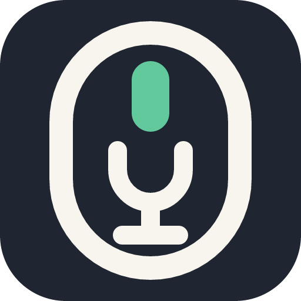
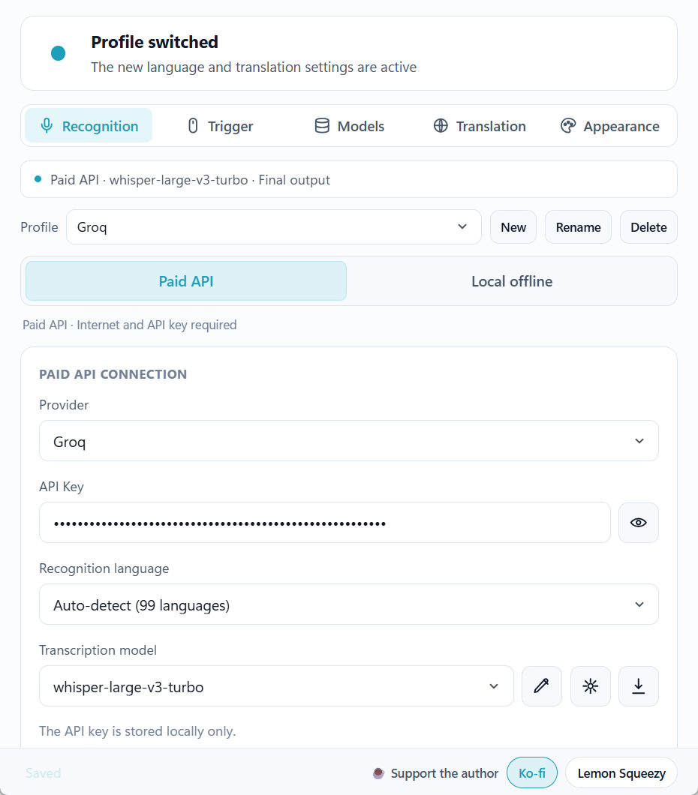
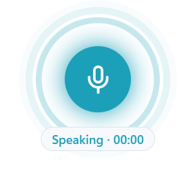

# Mouse Dictation

<p align="center">
  
</p>

**Speak and type into any app on Windows.** Hold a mouse button or hotkey, speak, then release to insert your text.

[Download for Windows](https://github.com/Kevinlabs26/Mouse-Dictation/releases/latest) · [Report an issue](https://github.com/Kevinlabs26/Mouse-Dictation/issues/new/choose)

## Download

For **Windows 10/11 · x64**.

| Version | Get started |
| --- | --- |
| [EXE installer](https://github.com/Kevinlabs26/Mouse-Dictation/releases/latest/download/Mouse-Dictation-windows-x64-setup.exe) | Install and launch. Recommended. |
| [Portable ZIP](https://github.com/Kevinlabs26/Mouse-Dictation/releases/latest/download/Mouse-Dictation-windows-x64-portable.zip) | Extract the entire folder, then run `mouse-dictation.exe`. |

The portable version requires [WebView2 Runtime](https://developer.microsoft.com/microsoft-edge/webview2/). Update it by replacing the extracted files; the in-app updater uses an installer. New or unsigned apps may show a Windows SmartScreen warning.

## Screenshots

<p align="center">
  
</p>

<p align="center">
  
</p>

## Features

- **Flexible input:** mouse press-and-hold or configurable global hotkeys.
- **Offline recognition:** local models, including a streaming mode that types while you speak.
- **Your own API:** OpenAI-compatible transcription providers.
- **Translation:** translate recognized text with an API provider or local Ollama.
- **Input tools:** personal dictionary, correction preview, and optional in-memory recent results for final-output dictation.
- **Profiles:** switch recognition, language, and translation settings together.

## Quick start

1. Select **Local offline** and download a model, or configure your transcription API.
2. Click the text field where you want to type.
3. Hold **F12**, speak, then release. Press **Esc** to cancel. You can also configure a mouse trigger.

Local recognition is free. API providers may charge for usage. Local streaming models do not use the dictionary or recent-results tools.

## Privacy

- Offline recognition keeps audio on your device.
- API recognition sends audio to your chosen provider; translation sends recognized text to its provider.
- API keys use the system credential manager. Recent results are off by default and stay in memory when enabled.
- No telemetry or advertising.

[Privacy details](PRIVACY.md) · [Security audit](SECURITY_AUDIT_2026-10-24.md)

## Development

Requires Node.js, npm, Rust, and the Tauri build prerequisites.

```powershell
npm ci
npm run tauri:dev
```

Build installers with `npm run tauri:build`, or a portable ZIP with `npm run package:portable`.

## License

[Apache 2.0](LICENSE).
