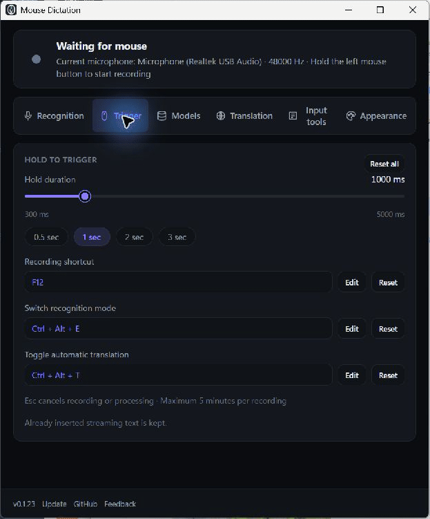
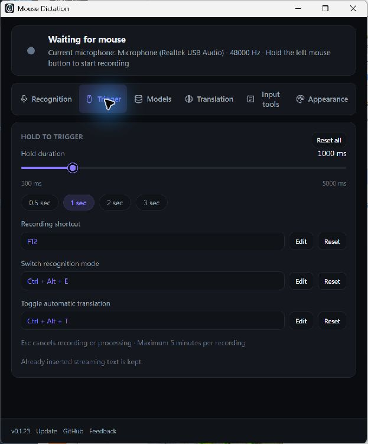

# Mouse Dictation

<p align="center">
  
</p>

<p align="center"><strong>Fast, private speech input for Windows</strong><br>Hold the left mouse button, or use a global hotkey, to transcribe speech directly into the active text field.</p>

<p align="center">
  <a href="https://github.com/Kevinlabs26/Mouse-Dictation/releases/latest"><strong>Download for Windows</strong></a>
  · <a href="https://github.com/Kevinlabs26/Mouse-Dictation/issues/new/choose">Report a problem</a>
  · <a href="https://github.com/Kevinlabs26/Mouse-Dictation">Star on GitHub</a>
</p>

Mouse Dictation is a free, open-source voice typing and speech-to-text app for Windows 10/11. Use mouse dictation or a global hotkey to type into the active text field, with local offline speech recognition or your own transcription API.

## Download and get started

Use the [latest GitHub release](https://github.com/Kevinlabs26/Mouse-Dictation/releases/latest) as the download source.

| Download | How to use |
| --- | --- |
| Windows x64 `.exe` installer — recommended | Run the installer, then open Mouse Dictation. |
| `Mouse-Dictation-windows-x64-portable.zip` — installation-free | Extract the **entire folder**, then run `mouse-dictation.exe`. Keep its DLLs beside it. If an older release has no ZIP, use the installer. |

1. Choose **Local offline** and download a model once, or enter your own transcription API key. Local inference is free; online providers may charge for API usage.
2. Open Notepad or another app and click its text field.
3. Hold **F12**, speak, then release to insert the result. Mouse press-and-hold is also available. Press **Esc** to cancel.

The installation-free version requires [Microsoft Edge WebView2 Runtime](https://developer.microsoft.com/microsoft-edge/webview2/). Settings and models still use your Windows user folders, and keys use Windows Credential Manager. To remain installation-free, update by replacing the extracted app files with a new ZIP; the in-app updater uses the standard installer.

New or unsigned Windows apps may show a SmartScreen warning. Code signing can identify the publisher, but does not guarantee immediate reputation. Verify the download source; do not disable Windows security protections. See [Microsoft's explanation](https://learn.microsoft.com/en-us/windows/apps/package-and-deploy/smartscreen-reputation).

## 28-second interface demo



This clip uses the real Windows app and sample text, captured before the v0.1.24 version bump. It shows `Open AI` corrected to `OpenAI` through a local, unsaved dictionary preview, plus shortcut settings and the GitHub/feedback buttons. It does not record audio or send a transcription request. [Download the MP4](docs/images/interface-demo.mp4).

## Screenshots

<table>
  <tr>
    <td align="center">
      <br>
      <sub>Mouse hold duration, global shortcuts, and the GitHub/feedback links.</sub>
    </td>
    <td align="center">
      <br>
      <sub>Compact speaking overlay with the elapsed recording time.</sub>
    </td>
  </tr>
</table>

The application icon is shared across the Windows executable, installer, and tray assets.

Current version: `0.1.24`

## Features

- Mouse press-and-hold or configurable global hotkeys
- Microphone selection with an explicit system-default option and device availability status
- Paid transcription APIs through OpenAI-compatible endpoints
- Local offline transcription with sherpa-onnx
- Realtime local transcription with a streaming Zipformer model
- Automatic translation after transcription
- Configurable recognition languages, models, themes, and profiles
- API keys stored in the operating system credential manager
- Windows Unicode text input without replacing the clipboard
- System tray support and optional launch at startup

## Development

API keys use endpoint-bound snapshots in the operating system credential store;
settings and profiles contain references only. Old configurations migrate when
loaded. A failed credential read blocks overwriting that configuration until
credential-store access is restored and the app restarted. Older app versions
do not understand the new references and may require keys to be entered again.

Local dependency security patches are documented in
[vendor/PATCHES.md](src-tauri/vendor/PATCHES.md). The updater accepts current
Tauri 2 EXE/MSI artifacts; legacy Tauri 1 ZIP updater compatibility is disabled.

Requirements:

- Node.js and npm
- Rust and the Tauri prerequisites for your operating system

Install dependencies and start the development app:

```powershell
npm install
npm run tauri:dev
```

Build the production application:

```powershell
npm run tauri:build
```

## Recognition modes

### Paid API

Configure an OpenAI-compatible API Base URL, API key, and transcription model in the Recognition tab. The default workflow starts recording after the mouse button is held for one second, then sends the recording to `/audio/transcriptions` when the button is released.

The Recognition tab also selects the microphone for both API and local modes. An empty selection follows the system default; a selected device that disconnects produces an error instead of silently switching microphones. Refresh the list after connecting a headset. Overlay waves indicate changing microphone input, including background noise, rather than confirmed speech. On Windows, holding a window title bar or resize border does not trigger mouse dictation. Releasing stops the recording overlay before transcription begins.

Each dictation keeps its starting recognition, language, translation and correction settings. One dictation runs at a time, including microphone startup and recognition; wait for completion or press Esc before starting another. Startup runs in the background. Esc cancels startup, recording or pending output, and holding a canceled shortcut cannot restart it until the key is released. Already inserted streaming text remains. An already sent API request or an in-progress native model call may finish in the background; its canceled result is ignored and no further retry or translation fallback is started.

On Windows, automatic input checks the original foreground window and native focused control. If either changes or becomes unavailable, input is stopped. This check cannot distinguish two fields inside the same browser/webview that share a native control. Available text from failed insertion or translation appears in a temporary recovery panel even when history is off; copy or discard it explicitly. The panel keeps only the latest result in page memory and clears on a new dictation, cancellation, discard or app exit. It does not write a history file or change the clipboard automatically.

Remote API endpoints must use HTTPS. HTTP is allowed only for `localhost` or literal loopback IP addresses, including `127.0.0.1` and `::1`, so local services such as Ollama continue to work. Plain HTTP on a LAN or public address is rejected before sending credentials or audio.

Realtime streaming depends on the provider and model. The paid API workflow currently uses final output after recording.

The request timeout scales with recording length (90 seconds minimum, 11 minutes maximum). Connection failures and temporary HTTP errors (429, 500, 502, 503, 504) can be retried once. Short numeric `Retry-After` instructions are honored; longer or date-based delays are returned as errors. Upload/response timeouts are not automatically retried because the provider may already have processed the audio.

On Windows, recognized text is entered through Unicode keyboard events without replacing clipboard contents. The target app must accept simulated text input and run with compatible permissions. Other platforms currently use clipboard-based paste.

### Local offline

The high-accuracy mode downloads and configures a SenseVoice int8 model. The realtime mode uses a streaming Zipformer model and inserts stable partial results while speaking.

Local mode processes audio on the device and supports manually selected model directories. Official model downloads are available from the [sherpa-onnx ASR models](https://github.com/k2-fsa/sherpa-onnx/releases/tag/asr-models) page.

## Input tools

The **Input tools / 输入助手** tab adds optional helpers for final-output dictation (paid API and local non-streaming models):

- **Multilingual personal dictionary:** edit rules visually with source text, replacement, language scope, exact-phrase/whole-word matching and optional case-insensitivity. English/French words can use whole-word matching; Chinese/Japanese phrases can use exact matching. An empty replacement deletes the matched text. Up to 256 rules / 32 KiB serialized data. Click **Save dictionary** to apply changes; drafts are not committed by other settings. Existing `source => replacement` dictionaries load with their original matching behavior and migrate to structured JSON on explicit save, without losing rules. This is post-transcription correction, not model hotword training.
- **Language scope:** common (`*`) rules apply to every selected recognition language; scoped rules apply only to that configured language. Automatic language selection applies common rules only and does not guess a language from the text. Longest actual match wins; a language-specific rule wins an equal-length tie over a common rule. Replacements do not cascade. Unicode lowercase comparison is supported, but locale-specific case folding and accent normalization are not; whole-word boundaries include letters, numbers, combining marks and underscore.
- **Test corrections:** preview unsaved rules against sample text using the same Rust matcher as dictation, without API calls, automatic text insertion, or history writes. Preview input is limited to 32 KiB. Dictionary processing accepts at most 1 MiB of input and output; excessive expansion reports an error rather than truncating text. **Add correction** on a recent result loads the raw transcription as test input and creates an empty rule; enter the incorrect fragment and correction, test, then save. Nothing is learned automatically.
- **Explicit formatting markers:** optionally convert literal `【换行】` / `[newline]` into a line break and `【分段】` / `[paragraph]` into a blank line. Ordinary spoken “new line” is not a command. No send/delete actions are executed.
- **Recent results:** off by default. When enabled, up to 10 results and their original transcription stay in application memory, not on disk. Clear them manually, turn retention off, or quit to remove them. Translation or insertion failures retain available text for explicit clipboard copying; failed transcription audio is not retained or retried through this panel.

Local streaming models are unchanged and do not use these helpers, even when their output option is set to final output. **Copy result / Copy original** intentionally changes the clipboard only when clicked; switch to the desired window and paste manually. Dictionary rules are part of local settings/profiles; result history is not.

## Translation

Automatic translation can be enabled after transcription. You can use a configured OpenAI-compatible translation provider or a local Ollama model. Translation sends the transcribed text to the selected provider; local Ollama keeps the request on the device.

## Data and privacy

- Local offline mode does not upload recordings.
- Paid API mode sends recordings to the API provider configured by the user.
- Automatic translation sends transcribed text to the selected translation provider.
- API keys are stored in the system credential manager rather than the normal settings file.
- The application does not include telemetry, advertising, or background analytics.

See [`PRIVACY.md`](PRIVACY.md) for details.

## First-run permissions

On Windows, allow microphone access when requested. On macOS, microphone, Accessibility, and Input Monitoring permissions may be required for global mouse listening and simulated text input.

## Release checklist

Before publishing a Windows release, test the application on a clean machine without the development environment installed:

- First launch and microphone permissions
- System tray and launch-at-startup behavior
- Mouse trigger and global hotkeys
- Holding another window's title bar/resize border, releasing immediately after activation, and Esc cancellation
- Esc during microphone startup, recognition, translation and modifier-key waits; holding F12 after cancellation
- Switching profiles mid-recording preserves the original settings and shortcut release; a second dictation waits for completion
- Changing the foreground window prevents automatic insertion; pending text remains available for explicit copy/discard with history off
- Overlay visibility and recording timer
- Selected microphone, quiet speech, low sample-rate headset input, and device disconnect errors
- Local model download and deletion
- Paid API transcription
- Automatic translation
- Installer and uninstall flow

The Windows release currently uses an NSIS installer. Code signing is recommended for public distribution.

To build and package an installation-free Windows x64 app, run `npm run package:portable`. It runs a Tauri production build with bundled frontend assets before packaging; a plain `cargo build --release` can still produce an app that expects the development server. The ZIP is written to `src-tauri/target/release/bundle/portable/` (or the corresponding `CARGO_TARGET_DIR`). Packaging verifies the reviewed native libraries and copies only the executable, four runtime DLLs, license, privacy notice and quick-start instructions. It excludes settings, recordings and API keys.

New release workflows also upload fixed filenames `Mouse-Dictation-windows-x64-setup.exe` and `Mouse-Dictation-windows-x64-portable.zip`. The `/releases/latest` page stays the main download link across versions. Publishing requires a new release; preparing these files locally does not publish them.

Windows Authenticode signing and Tauri updater signatures serve different purposes. The existing updater signature does not make Windows display a verified publisher. Production Authenticode signing requires a separately configured signing identity; no certificate or paid signing service is configured by this change.

## License

The source code is available under the [Apache License 2.0](LICENSE). The Mouse Dictation name, brand, and icon are not granted as trademarks by that license.

## Performance notes

Recording and global mouse listening run in Rust background threads. Local inference runs through sherpa-onnx; online performance depends mainly on network latency and the selected provider. Local performance depends on CPU speed, model size, and the first model load.
